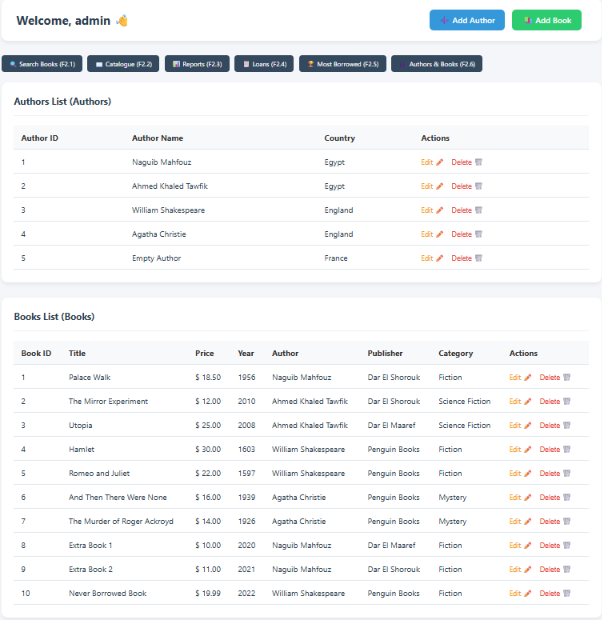
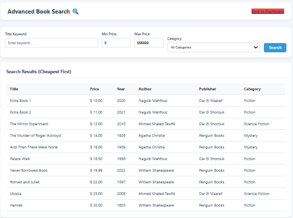

# Library Management System

A web-based Library Management System built with Flask and MySQL. It manages a comprehensive normalized database containing authors, publishers, categories, books, members, and loans, supporting advanced SQL queries, reports, and an English LTR interface.

**Course:** Database Systems Lab  
**Faculty:** Alexandria National University

---

## 1. Team

| Name | ID | Contributions |
|---|---|---|
| Mohamed Ali Mohamed | 2304105 | Database schema design, MySQL queries, Flask backend routing, database connectivity, and frontend integration |
| Waleed Mohamed Ibrahim | 2304097 | Frontend design, HTML5 templates, CSS3 styling, UI layout, and LTR interface optimization |

---

## 2. Technology Stack

- **Backend:** Python with Flask framework
- **Frontend:** HTML5, CSS3 (English interface with LTR direction)
- **Database:** MySQL (`library_db`), utilizing raw SQL and explicit joins without an ORM
- **Database Connectivity:** `mysql-connector-python`
- **Architecture:** Multi-table relational schema with referential integrity and cascading rules

---

## 3. How to Run It

1. Install Python and MySQL Server (MySQL Workbench recommended).
2. Clone or download this project repository.
3. Open MySQL Workbench and execute the DDL script to create the database and tables.
4. Insert initial test records using the DML script.
5. Configure your database credentials (`host`, `user`, `password`, `database`) in `app.py`.
6. Open your terminal in the project directory and install dependencies:

```bash
pip install Flask mysql-connector-python
```

7. Run the application:

```bash
python app.py
```

8. Open your web browser and navigate to:

```text
http://127.0.0.1:5000
```

---

## 4. Database Schema Design

The project uses a normalized six-table relational database named `library_db`:

1. **`AUTHOR`**: Stores author details (`author_id`, `name`, `country`).
2. **`PUBLISHER`**: Stores publisher details (`publisher_id`, `name`, `country`).
3. **`CATEGORY`**: Stores book categories (`category_id`, `name`).
4. **`BOOK`**: Stores book details (`book_id`, `title`, `price`, `publish_year`, `author_id`, `publisher_id`, `category_id`).
5. **`MEMBER`**: Stores library member details (`member_id`, `name`, `email`, `phone`).
6. **`LOAN`**: Tracks book borrowings (`loan_id`, `book_id`, `member_id`, `loan_date`, `return_date`).

### Relationships & Integrity
- Foreign keys link books to authors, publishers, and categories.
- `ON DELETE CASCADE` rules ensure referential consistency across related entities.

---

## 5. Implemented Features & Queries (F2.1 – F2.6)

- **F2.1 — Advanced Book Search (`/search`):** Search books by title keyword (`LIKE`), price range (`BETWEEN`), and category filter, automatically ordered by price (`ORDER BY price ASC`).
- **F2.2 — Complete Catalogue (`/catalogue`):** Displays all books with their corresponding author, publisher, and category names using multi-table `JOIN` operations.
- **F2.3 — Reports & Statistics (`/reports`):** Provides total book counts and average prices per category (`GROUP BY`), prolific authors with 2+ books (`HAVING`), and library-wide price summaries (`SUM`, `MIN`, `MAX`).
- **F2.4 — Loans Management (`/loans`):** Tracks active unreturned loans (`return_date IS NULL`), identifies inactive members who never borrowed a book (`LEFT JOIN` with `IS NULL`), and lists unborrowed books.
- **F2.5 — Most Borrowed (`/most_borrowed`):** Highlights the top 3 most borrowed books and the most active library member using aggregation and sorting (`LIMIT 3`).
- **F2.6 — Authors & Books (`/authors_books`):** Computes book counts per author (including those with zero books via `LEFT JOIN`) and filters books where the author and publisher share the same country.

---

## 6. Screenshots

### Dashboard


### Advanced Book Search (F2.1)


### Library Reports (F2.3)


---

## 7. Conclusion

The Library Management System successfully implements a multi-table relational database with Flask, fulfilling all functional requirements, complex SQL queries, cascading actions, and an intuitive LTR web interface.
